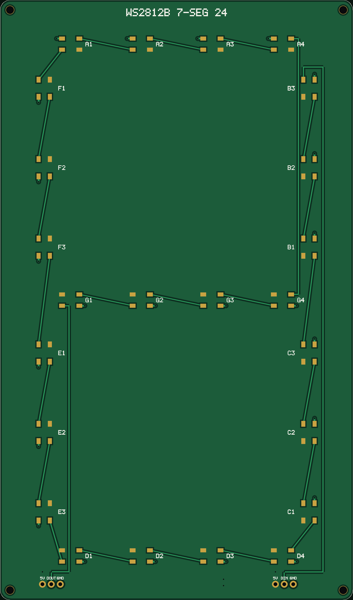
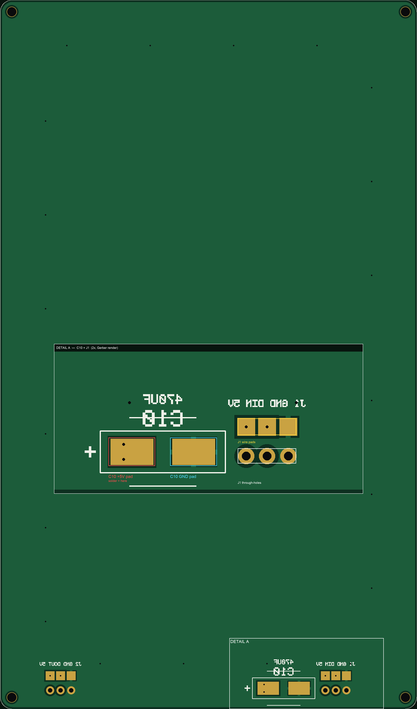

# WS2812B 7-segment display — 100 × 170 mm, 2-layer

24 × WS2812B 5050 forming a 7-segment digit (80 × 150 mm). **Top:** 5 V pour +
data chain + 24 LEDs. **Bottom:** solid GND plane, **3 solder pads per connector**
for your wires, and the **C10 470 µF** pads (customer-installed on the back).
Connectors are both on the bottom edge — J1 in on the right, J2 out on the left.

**Status:** PCB design gerbers (Gerber X2) submitted to JCLPCB on **October 18, 2026**.
Top layer masking/cutting reference files (G-code and PNG diagrams) added October 21, 2026.




> The bottom image is drawn as seen from the **top** (through the board), so the
> bottom silkscreen appears mirrored; flip the board in your hand and it reads
> normally.

| | |
|---|---|
| Board | **100 × 170 mm, 2 layers**, 1.0 mm FR4, 1 oz, HASL, green |
| Top | 5 V pour + data chain + 24 LEDs |
| Bottom | solid GND plane + 6 wire pads + C10 pads + bottom silk |
| LEDs | 24 × WS2812B: A/G/D = 4 each, B/C/E/F = 3 each |
| Bulk cap | **C10, 470 µF 10 V SMD**, not placed by the fab — 5.0 × 3.0 mm pads on the back |
| Connectors | **J1 right, J2 left, bottom edge**, 1×3 2.54 mm THT **plus 3 back pads each** |
| Holes | **36 PTH** (6 header + 24 LED grounds + 2 C10 + 4 wire-pad vias), 4 NPTH |
| Finish | HASL lead-free |

---

## 1. J1 / J2 — holes *and* surface pads

Each connector now has **two ways to connect**, both on the same three nets:

**a) The through-holes** (for a 1×3 header or wire-through)
1.0 mm drilled, plated, 1.8 mm pad on both sides, mask open on both sides.

**b) Three back-side surface solder pads** (what you asked for)
2.0 × 2.0 mm, at the same 2.54 mm pitch, 3.5 mm inboard of the holes:

| J1 pad (x, y) | Net | Via to top |
|---|---|---|
| (78.00, 8.0) | +5 V | 0.3 mm via into the 5 V pour |
| (80.54, 8.0) | DIN | 0.3 mm via into the data trace |
| (83.08, 8.0) | GND | thermal relief into the bottom GND plane |

| J2 pad (x, y) | Net | Via to top |
|---|---|---|
| (12.00, 8.0) | +5 V | 0.3 mm via into the 5 V pour |
| (14.54, 8.0) | DOUT | 0.3 mm via into the data trace |
| (17.08, 8.0) | GND | thermal relief into the bottom GND plane |

So **+5 V and data each get a dedicated via** from the back pad to the top layer;
GND doesn't need one because the back pad sits directly on the GND plane. The
through-holes remain available if you later decide to fit headers or pass a wire
through the board. You can solder your wires flat on the 2 × 2 mm back pads
(no need to fill the holes).

The through-hole pads are still there and plated — they were simply not visible
in the old preview because the drill holes were not drawn. The new bottom image
shows both the 1.0 mm holes and the 0.3 mm vias as black dots.

**LED grounds** are separate: each LED GND pad is isolated from the top 5 V pour
and tied by a short trace to a 0.3 mm via down to the bottom GND plane (24 of
them).

**C10 on the back:** pads on `B_Cu`; the **+** pad has two 0.3 mm vias into the
top 5 V pour, the **–** pad has a 4-spoke thermal relief into the GND plane.
`B_Silkscreen` marks the body, the `+`, and mirrored `C10 470uF`.

---

## 2. What the fab places, and how it knows where

| File | Content |
|---|---|
| `CPL_JLCPCB.csv` | **24 rows, LEDs only** — designator, X, Y, layer, rotation |
| `BOM_JLCPCB.csv` | **one line: 24 × WS2812B (C2761795)** |
| `F_Paste.gtp` / `F_Mask.gts` | stencil apertures / mask openings |

C10 and J1/J2 are **not in the CPL and not in the assembly BOM** — the fab places
only the 24 LEDs. `BOM_full.csv` lists C10 and the headers as *DNP*.

The pick-and-place machine uses X/Y/rotation from the CPL; it never reads the
silkscreen. The LEDs are at **0 / 90 / 180 / 270°**. Check **B3** (first CPL row)
or **D1** in the fab preview; if the part's zero differs, add the same offset to
all 24.

---

## 3. Layout, names and labels

**Chain** (right → left):

```
J1.2 (DIN) → B3 → B2 → B1 → C3 → C2 → C1 → D4 → D3 → D2 → D1
           → E3 → E2 → E1 → F3 → F2 → F1 → A1 → A2 → A3 → A4
           → G4 → G3 → G2 → G1 → J2.2 (DOUT)
```

Every LED has its reference **beside** it (`A1…A4`, `B1…B3`, `C1…C3`, `D1…D4`,
`E1…E3`, `F1…F3`, `G1…G4`) — not underneath. The top silk also has
`5V / DIN / GND` and `5V / DOUT / GND`; the bottom silk repeats
`J1 GND DIN 5V` and `J2 GND DOUT 5V` next to the wire pads.

**Digit geometry** (origin bottom-left, mm):

| Segment | LEDs | LED centres | PVC cutout |
|---|---|---|---|
| A | 4 | (20/40/60/80, 157.5) | 17,154 → 83,161 |
| G | 4 | (20/40/60/80, 85) | 17,81.5 → 83,88.5 |
| D | 4 | (20/40/60/80, 12.5) | 17,9.5 → 83,16.5 |
| F | 3 | (12.5, 145/122.5/100) | 9,97 → 15.5,148 |
| B | 3 | (87.5, 100/122.5/145) | 84.5,97 → 91,148 |
| E | 3 | (12.5, 70/47.5/25) | 9,22 → 15.5,73 |
| C | 3 | (87.5, 25/47.5/70) | 84.5,22 → 91,73 |

`segment_mask.dxf`: 7 apertures (`CUT`), board outline, 4 holes, A–G labels
(`LABEL`), 1.5 mm bridges.

**7-Segment Display Digit Map** — Which segments to light for digits 0–9:

```
Standard 7-segment layout:
   A
  F B
   G
  E C
   D
```

| Digit | A | B | C | D | E | F | G | Pattern |
|-------|---|---|---|---|---|---|---|---------|
| **0** | ● | ● | ● | ● | ● | ● | ◯ | ░░░░░░ (6 segments) |
| **1** | ◯ | ● | ● | ◯ | ◯ | ◯ | ◯ | ░░ (2 segments: B, C) |
| **2** | ● | ● | ◯ | ● | ● | ◯ | ● | ░░░░░ (5 segments) |
| **3** | ● | ● | ● | ● | ◯ | ◯ | ● | ░░░░░ (5 segments) |
| **4** | ◯ | ● | ● | ◯ | ◯ | ● | ● | ░░░░ (4 segments) |
| **5** | ● | ◯ | ● | ● | ◯ | ● | ● | ░░░░░ (5 segments) |
| **6** | ● | ◯ | ● | ● | ● | ● | ● | ░░░░░░ (6 segments) |
| **7** | ● | ● | ● | ◯ | ◯ | ◯ | ◯ | ░░░ (3 segments: A, B, C) |
| **8** | ● | ● | ● | ● | ● | ● | ● | ░░░░░░░ (all 7 segments) |
| **9** | ● | ● | ● | ● | ◯ | ● | ● | ░░░░░░ (6 segments) |

Legend: **●** = segment ON (lit), **◯** = segment OFF (dark)

**Examples:**
- `0`: light A, B, C, D, E, F
- `1`: light B, C only
- `8`: light all segments A–G
- `9`: light A, B, C, D, F, G (E is off)

---

## 4. Fitting C10 on the back

* C10 at **(68, 5)**, body 8.5 × 8.5 mm, 10.5 mm tall, on the **back**.
* Pads: **+5 V at (64.3, 5)**, **GND at (71.7, 5)**, **5.0 × 3.0 mm** (enlarged for hand soldering).
* The **+** on `B_Silkscreen` is next to the 5 V pad.
* Front stays flat for the PVC; leave ~12 mm behind the panel for the cap.
* Pads are opened by `B_Mask`, no paste (hand solder).

---

## 5. Power and signal

* 1.44 A worst case (24 × 60 mA); use 5 V / 3 A.
* **3.3 V logic into 5 V WS2812B is marginal** (V<sub>IH</sub> ≈ 3.5 V). Use a
  74AHCT125 or run the LEDs at 4.0–4.5 V.
* 330–470 Ω in series with DIN at J1.
* Data 0.3 mm over the bottom GND plane.

---

## 6. Ordering

1. Upload `out/WS2812B-7SEG-2L_gerbers.zip`; 2 layers, 100 × 170 mm, 1.0 mm, HASL.
2. PCB Assembly → **top side only**; upload `BOM_JLCPCB.csv` + `CPL_JLCPCB.csv`.
3. Do **not** add C10 or the headers to the assembly list.
4. Check B3/D1 rotation in the placement preview.

---

## 7. Verification

* 5 V top pour: **one region, 26/26 pads**;
* data: **25/25 links**, no shared copper;
* top GND: **24 islands, 24/24 pad-to-via**;
* bottom GND plane: **one region, 29/29 targets** (24 LED vias + J1.3 + J2.3 +
  C10 GND + 2 back-pad GNDs);
* C10: 1 back-side 5 V island, 2 vias to top, clear of the plane;
* J1/J2: **6 back pads, 4 vias to the top nets**, all isolated from the plane;
* all nets ≥ 0.20 mm after 0.10 mm dilation; **36 PTH + 4 NPTH** aligned;
* silkscreen clear of pads; DXF valid;
* **previews are rendered from the parsed Gerber layers**, not from the
  design tables, and the script asserts that the C10 pads exist in `B_Cu`
  (5.0 × 3.0) and `B_Mask` (5.1 × 3.1) and are gold at the correct pixel in
  `preview_bottom.png`;
* every pad's mask opening is checked: **102 top, 14 bottom**.

Not verified: thermal, EMC, firmware, LED binning, PVC fit, fab DFM.

---

## 8. Design & Development

**Design Tool:** [DeepSeek Desktop App](https://deepseek.com/) with v4_flash mode  
**Workflow:** PCB design created iteratively via natural-language prompts  
**Workspace:** `/Users/<uid>/Documents/deepseek-harness/default-workspace/led7seg/`

### Recent Updates
- **October 18, 2026:** Gerber files (X2 format) submitted to JCLPCB for fabrication
- **October 21, 2026:** Top layer masking board G-code and reference PNG diagrams added for CNC cutting and assembly guidance

---

## 9. Files

```
out/
├── WS2812B-7SEG-2L_gerbers.zip       ← fabrication (10 files, submitted to JCLPCB Oct 18)
├── gerbers/                           ← F/B Cu, F/B mask, F/B silk, paste, outline, PTH, NPTH
├── BOM_JLCPCB.csv                     ← 24 LEDs only
├── BOM_full.csv                       ← LEDs + C10 (DNP) + J1/J2 (DNP)
├── CPL_JLCPCB.csv                     ← 24 LEDs, rotations only
├── segment_mask.dxf                   ← PVC cut-out drawing
├── preview_top.png                    ← top: 5 V pour, data, refs
├── preview_bottom.png                 ← bottom: plane, wire pads, C10, holes
│                                         + overlaid 2x C10/J1 detail panel
├── c10_zoom.png                       ← 2x close-up: C10 pads + J1 pads/holes
│
├── segments_cut.gcode                 ← G-code for top layer masking board (CNC cutting)
├── segments_cut_dimensions.png        ← reference diagram with cutting dimensions
├── c10_back_annotated.png             ← reference diagram: C10 back-side placement
├── bottom_silk_check.png              ← reference diagram: bottom silkscreen layout
├── zoom_c10.png                       ← additional close-up detail: C10 placement
└── zoom_c10_now.png                   ← additional close-up detail: current C10 configuration
```

Regenerate:

```bash
python3 make_board.py
python3 verify.py
```

---

## 10. Python Scripts — Build, Verify, and Cut

This project uses three Python scripts to automate PCB design, validation, and manufacturing:

### `make_board.py` — Generate Gerber Files & Documentation

**Purpose:** Core PCB design generator that creates all manufacturing files from parametric definitions.

**Inputs:**
- Hardcoded LED placement coordinates (SEGMENTS dictionary)
- Board geometry: 100 × 170 mm, 2-layer FR4
- Connector locations (J1/J2 at bottom edge)
- C10 capacitor placement (back side)

**Outputs:**
- **Gerber files** (inside `out/gerbers/`):
  - `WS2812B-7SEG-2L-F_Cu.gtl` — Front copper layer (5 V pour, data chain, 24 LEDs)
  - `WS2812B-7SEG-2L-B_Cu.gbl` — Back copper layer (GND plane, back pads, vias)
  - `WS2812B-7SEG-2L-F_Mask.gts` — Front solder mask openings
  - `WS2812B-7SEG-2L-B_Mask.gbs` — Back solder mask openings
  - `WS2812B-7SEG-2L-F_Paste.gtp` — Front paste stencil (LEDs only)
  - `WS2812B-7SEG-2L-F_Silkscreen.gto` — Front reference designators & labels
  - `WS2812B-7SEG-2L-B_Silkscreen.gbo` — Back connector labels & C10 marking
  - `WS2812B-7SEG-2L-Edge_Cuts.gm1` — Board outline with 3.0 mm rounded corners
  - `WS2812B-7SEG-2L-PTH.txt` — Plated through-hole drill file (36 holes)
  - `WS2812B-7SEG-2L-NPTH.txt` — Non-plated through-hole file (4 corner mounting holes)
- **Bill of Materials (BOM):**
  - `BOM_JLCPCB.csv` — Assembly list for JCLPCB (24 × WS2812B only)
  - `BOM_full.csv` — Complete list including hand-soldered components (C10, J1, J2)
- **Pick & Place (CPL):**
  - `CPL_JLCPCB.csv` — Coordinates, layer, and rotation for 24 LEDs
- **Supporting Files:**
  - `WS2812B-7SEG-2L_gerbers.zip` — Compressed Gerber archive ready for fab submission
  - `segment_mask.dxf` — DXF file for PVC overlay cutting (7 segments + mounting holes + labels)
  - `preview_top.png` — Rendered top layer visualization
  - `preview_bottom.png` — Rendered bottom layer visualization
  - `c10_zoom.png` — Zoomed detail of C10 back-side placement

**Key Functionality:**
- Parametric LED chain definition (B3→...→G1, 24 total)
- Automatic pad and via routing based on LED orientation (0°/90°/180°/270°)
- 5 V copper pour on top layer with isolated LED grounds
- Solid GND plane on bottom with thermal reliefs for low-impedance power return
- Back-side surface pads for J1/J2 connectors (2.0 × 2.0 mm at 2.54 mm pitch)
- C10 (470 µF) pads on back with two 0.3 mm vias to 5 V pour
- Gerber generation using custom aperture code and polarity management

**Usage:**
```bash
python3 make_board.py
```

This regenerates all Gerber files, BOMs, and preview images in `out/`. Run this after modifying any design parameters (LED positions, board size, pad sizes, etc.).

---

### `verify.py` — Validate PCB Design Rules

**Purpose:** Comprehensive design validation that checks electrical connectivity, manufacturing constraints, and design integrity against actual Gerber files.

**Inputs:**
- Generated Gerber files (from `make_board.py`)
- Design parameters from `make_board.py` module

**Outputs:**
- Console verification report
- Raster images (for visual inspection):
  - `out/preview_top.png` — Rendered from parsed Gerber (shows actual manufactured copper)
  - `out/preview_bottom.png` — Back layer with detailed inset panels for C10 and J1 pads
  - Visual overlays with measurements and annotations

**Checks Performed:**

1. **5 V Power Network:**
   - Validates single contiguous region on top copper
   - Confirms all 26 pads (24 LEDs + 2 connectors) connect to 5 V

2. **Data Chain:**
   - Verifies 25 links (LED outputs → next LED inputs)
   - Ensures no shared copper between data signals

3. **GND Isolation & Plane:**
   - Checks 24 LED GND islands (one per LED)
   - Each island has exactly one 0.3 mm via to bottom GND plane
   - Bottom plane is single contiguous region with 29 targets (24 LED vias + connectors + C10)

4. **Capacitor (C10):**
   - Validates back-side pads exist in `B_Cu` and `B_Mask`
   - Confirms two 0.3 mm vias from +5 V pad to top pour
   - Verifies GND pad thermal relief pattern (4-spoke into plane)
   - Checks pixel-perfect pad placement in `preview_bottom.png`

5. **Connectors (J1/J2):**
   - 6 back-side surface pads (3 per connector)
   - 4 vias connecting to top nets (+5 V and data)
   - Isolation from GND plane where required

6. **Manufacturing Margins:**
   - All traces ≥ 0.20 mm after 0.10 mm dilation (JCLPCB minimum)
   - Board outline aligned (36 PTH + 4 NPTH verified)

7. **Silkscreen & Mask:**
   - Silkscreen clear of all pads (no text overlap)
   - 102 top mask openings + 14 bottom mask openings
   - Paste stencil (F_Paste) covers all LED pads

8. **Gerber Parsing & Rendering:**
   - Loads all Gerber files using `gerbonara` library
   - Renders objects (flashes, lines, regions) to raster images at 20× scale (20 px/mm)
   - Compares rendered images with design intent

**Usage:**
```bash
python3 verify.py
```

Run after `make_board.py` to validate the design before submission. Exit code 0 = all checks pass; errors halt execution with assertion messages.

**Dependencies:** `gerbonara`, `Pillow`, `numpy`, `scipy`

---

### `cut_files.py` — Generate CNC G-Code & Cutting Reference

**Purpose:** Creates manufacturing files for the PVC overlay/masking board (the physical fixture that holds and aligns the display).

**Inputs:**
- Segment geometry (A, G, D horizontal; B, C, E, F vertical)
- Tool specifications:
  - 2.0 mm end mill
  - Cutting depth: 5 mm (5 passes × 1 mm each)
  - Spindle: 12,000 RPM
  - Feed XY: 800 mm/min, Feed Z: 150 mm/min

**Outputs:**
- `out/segments_cut.gcode` — G-code file for CNC router/mill
- `out/segments_cut_dimensions.png` — Detailed dimensional drawing with annotations

**G-Code Features:**
- **Segment Paths:** Inward offset polygons for each of 7 segments (A–G)
- **Tool Geometry:** 2.0 mm end mill → 1.0 mm corners (bit radius = 1.0 mm)
- **Relief Lines:** Horizontal scan lines to clear chips from tall slots (10 mm wide)
- **Corner Holes:** 4 NPTH mounting holes (Ø 2.2 mm at corners)
- **Passes:** 5 sequential Z cuts (−1 mm to −5 mm) for clean edge finish
- **Safety:** 5 mm retract (SAFE_Z) between passes

**Segment Specifications:**
- **Horizontal (A, G, D):**
  - Length: 67.0 mm (flat 55 mm + 2 × 5 mm points)
  - Width: 12.0 mm (6 mm per side from centerline)
  - Clear gap: 4.0 mm between adjacent segments

- **Vertical (B, C, E, F):**
  - Length: 64.5 mm
  - Width: 12.0 mm
  - Spaced for 7-segment geometry

**PNG Reference Diagram:**
- Horizontal and vertical dimension lines with callouts
- Segment layout with measurements (X, Y coordinates in mm)
- Notation of cut depth, tool diameter, and pass information
- Color-coded detail boxes for critical dimensions

**Usage:**
```bash
python3 cut_files.py
```

Generates G-code suitable for:
- CNC router (Shopbot, Haas, etc.)
- Laser cutter (with Z-height emulation via power ramps) — *not recommended*
- 3-axis mill with 2.0 mm endmill

**Dependencies:** `Pillow` (image generation only)

---

## 11. Workflow Summary

**Typical Design Cycle:**

1. **Design/Edit Parameters:**
   - Modify `SEGMENTS`, `LEDS`, connector positions, or board size in `make_board.py`

2. **Generate Files:**
   ```bash
   python3 make_board.py
   ```
   Creates Gerbers, BOMs, CPL, DXF, and PNG previews in `out/`

3. **Validate Design:**
   ```bash
   python3 verify.py
   ```
   Checks electrical integrity, manufacturing compliance, and renders previews

4. **Generate Manufacturing Aids:**
   ```bash
   python3 cut_files.py
   ```
   Creates CNC G-code and dimensional reference for PVC overlay

5. **Submit to Fab:**
   - Upload `out/WS2812B-7SEG-2L_gerbers.zip` to JCLPCB
   - Upload `BOM_JLCPCB.csv` + `CPL_JLCPCB.csv` for assembly
   - Check placement preview (LED rotations)

6. **Manufacturing Support:**
   - Use `segments_cut.gcode` to cut PVC overlay
   - Print `segments_cut_dimensions.png` as reference
   - Use preview images for visual inspection and troubleshooting

---

## 12. Dependencies

Install required Python packages:

```bash
pip install gerbonara pillow numpy scipy
```

- **gerbonara** (≥ 0.9): Gerber file parsing and generation
- **Pillow**: Image rendering and manipulation
- **numpy**: Numerical array operations (for raster verification)
- **scipy**: Morphological operations (binary dilation for design rule checks)

---

## 13. LED Index to 7-Segment Mapping

The 24 LEDs are organized in the data chain as follows. Each segment maps to a range of LED indices:

| Segment | LEDs | Index Range | Notes |
|---------|------|-------------|-------|
| **B** | B3, B2, B1 | 0–2 | Right vertical, top |
| **C** | C3, C2, C1 | 3–5 | Right vertical, bottom |
| **D** | D4, D3, D2, D1 | 6–9 | Bottom horizontal |
| **E** | E3, E2, E1 | 10–12 | Left vertical, bottom |
| **F** | F3, F2, F1 | 13–15 | Left vertical, top |
| **A** | A1, A2, A3, A4 | 16–19 | Top horizontal |
| **G** | G4, G3, G2, G1 | 20–23 | Middle horizontal |

**Data Chain (LED Index Order):**
```
0(B3) → 1(B2) → 2(B1) → 3(C3) → 4(C2) → 5(C1) → 6(D4) → 7(D3) → 8(D2) → 9(D1)
→ 10(E3) → 11(E2) → 12(E1) → 13(F3) → 14(F2) → 15(F1) → 16(A1) → 17(A2) → 18(A3) → 19(A4)
→ 20(G4) → 21(G3) → 22(G2) → 23(G1)
```

**7-Segment Bit Mask** (for a single digit):
```python
# Segment-to-LED mapping as a bitmask or array
# where each bit/element represents whether a segment is lit
SEGMENT_BITS = {
    'A': [16, 17, 18, 19],      # Top
    'B': [0, 1, 2],              # Right top
    'C': [3, 4, 5],              # Right bottom
    'D': [6, 7, 8, 9],           # Bottom
    'E': [10, 11, 12],           # Left bottom
    'F': [13, 14, 15],           # Left top
    'G': [20, 21, 22, 23],       # Middle
}
```

---

## 14. Firmware: Arduino C & CircuitPython Examples

### Multi-Digit Display System

For the **SoccerTimer project**, four 7-segment displays are chained in series (using WS2812B's daisy-chain capability):
- **Digit 0:** 10-minute place (indices 0–23)
- **Digit 1:** 1-minute place (indices 24–47)
- **Digit 2:** 10-second place (indices 48–71)
- **Digit 3:** 1-second place (indices 72–95)

**Total: 96 LEDs across all four digits**

---

### Arduino C (with FastLED Library)

```cpp
#include <FastLED.h>

// Hardware configuration
#define NUM_LEDS 96          // 4 digits × 24 LEDs/digit
#define LED_PIN 5            // Data line to J1 (DIN)
#define BRIGHTNESS 30        // WS2812B brightness (0-255)

CRGB leds[NUM_LEDS];

// Segment-to-LED index mapping per digit
const uint8_t SEGMENT_LEDS[7][4] = {
    {16, 17, 18, 19},    // A (top)
    {0, 1, 2, 255},      // B (right-top, 3 LEDs, 255=unused)
    {3, 4, 5, 255},      // C (right-bottom)
    {6, 7, 8, 9},        // D (bottom)
    {10, 11, 12, 255},   // E (left-bottom)
    {13, 14, 15, 255},   // F (left-top)
    {20, 21, 22, 23},    // G (middle)
};

// 7-segment patterns for digits 0-9 and hex a-f (lowercase)
// Bit 0=A, bit 1=B, ..., bit 6=G
// This is a superset: 0-9 use same patterns as decimal, 10-15 are hex a-f
const uint8_t HEX_PATTERN[16] = {
    0b0111111,  // 0: A B C D E F
    0b0000110,  // 1: B C
    0b1011011,  // 2: A B D E G
    0b1001111,  // 3: A B C D G
    0b1100110,  // 4: B C F G
    0b1101101,  // 5: A C D F G
    0b1111101,  // 6: A C D E F G
    0b0000111,  // 7: A B C
    0b1111111,  // 8: all segments
    0b1101111,  // 9: A B C D F G
    0b1110111,  // a(10): A B C E F G (no D)
    0b1111100,  // b(11): C D E F G (no A, B)
    0b0111001,  // c(12): A D E F (no B, C, G)
    0b1011110,  // d(13): B C D E G (no A, F)
    0b1111001,  // e(14): A D E F G (no B, C)
    0b1110001,  // f(15): A E F G (no B, C, D)
};

// Color presets
#define COLOR_GREEN CRGB(0, 255, 0)
#define COLOR_RED CRGB(255, 0, 0)
#define COLOR_WHITE CRGB(255, 255, 255)
#define COLOR_OFF CRGB(0, 0, 0)

void setup() {
    FastLED.addLeds<WS2812B, LED_PIN, GRB>(leds, NUM_LEDS);
    FastLED.setBrightness(BRIGHTNESS);
    FastLED.show();
}

// Set a single digit (digit_index 0-3, value 0-15, color)
// Value 0-9: decimal digits
// Value 10-15: hex a-f (lowercase)
void set_digit(uint8_t digit_index, uint8_t digit_value, CRGB color) {
    if (digit_value > 15) return;  // Invalid digit (max is 'f' = 15)
    
    uint8_t base_led = digit_index * 24;
    uint8_t pattern = HEX_PATTERN[digit_value];
    
    for (uint8_t segment = 0; segment < 7; segment++) {
        CRGB segment_color = (pattern & (1 << segment)) ? color : COLOR_OFF;
        
        for (uint8_t led_idx = 0; led_idx < 4; led_idx++) {
            uint8_t led_offset = SEGMENT_LEDS[segment][led_idx];
            if (led_offset != 255) {  // 255 = unused (segments have 3-4 LEDs)
                leds[base_led + led_offset] = segment_color;
            }
        }
    }
}

// Main sports timer function
// Parameters: minutes (0-99), seconds (0-59)
// Behavior:
//   - If min=0: hide 10min and min digits, show seconds
//   - If min>0: show all, green color
//   - If min=0: seconds in red
//   - If sec<20 in final minute: alternate red/white every 500ms
//   - If min=0 && sec=0: all white
void display_timer(uint8_t min, uint8_t sec) {
    uint8_t tens_min = min / 10;
    uint8_t ones_min = min % 10;
    uint8_t tens_sec = sec / 10;
    uint8_t ones_sec = sec % 10;
    
    // Millisecond counter for blinking effect
    unsigned long now = millis();
    bool is_red = ((now / 500) % 2) == 0;  // Toggle every 500ms
    
    CRGB color_sec;
    
    if (min == 0 && sec == 0) {
        // Special case: 0:00 - all white
        set_digit(0, 0, COLOR_WHITE);
        set_digit(1, 0, COLOR_WHITE);
        set_digit(2, 0, COLOR_WHITE);
        set_digit(3, 0, COLOR_WHITE);
    } else if (min == 0) {
        // Last minute: hide tens_min and ones_min, show seconds only
        clear_digit(0);
        clear_digit(1);
        
        // Color logic for last minute
        if (sec < 20) {
            // Last 20 seconds: alternate red/white
            color_sec = is_red ? COLOR_RED : COLOR_WHITE;
        } else {
            // Last minute, >20s: solid red
            color_sec = COLOR_RED;
        }
        
        set_digit(2, tens_sec, color_sec);
        set_digit(3, ones_sec, color_sec);
    } else {
        // Show all four digits in green
        set_digit(0, tens_min, COLOR_GREEN);
        set_digit(1, ones_min, COLOR_GREEN);
        set_digit(2, tens_sec, COLOR_GREEN);
        set_digit(3, ones_sec, COLOR_GREEN);
    }
    
    FastLED.show();
}

void clear_digit(uint8_t digit_index) {
    uint8_t base_led = digit_index * 24;
    for (uint8_t i = 0; i < 24; i++) {
        leds[base_led + i] = COLOR_OFF;
    }
}

// Hex display function - displays 4 hex digits (0x0000 to 0xFFFF)
// Only the lower 4 hex digits are displayed (value & 0xFFFF)
// Hex values are displayed in lowercase (0-9, a-f)
void display_hex(uint16_t hex_value) {
    // Mask to 16-bit (4 hex digits)
    hex_value = hex_value & 0xFFFF;
    
    // Extract each hex digit
    uint8_t d0 = (hex_value >> 12) & 0x0F;  // Most significant hex digit
    uint8_t d1 = (hex_value >> 8) & 0x0F;
    uint8_t d2 = (hex_value >> 4) & 0x0F;
    uint8_t d3 = (hex_value >> 0) & 0x0F;  // Least significant hex digit
    
    // Display all four hex digits in white using set_digit()
    set_digit(0, d0, COLOR_WHITE);
    set_digit(1, d1, COLOR_WHITE);
    set_digit(2, d2, COLOR_WHITE);
    set_digit(3, d3, COLOR_WHITE);
    
    FastLED.show();
}

void loop() {
    // Example: display countdown from 5:00 to 0:00
    static unsigned long last_update = 0;
    unsigned long now = millis();
    
    if (now - last_update >= 100) {  // Update every 100ms
        last_update = now;
        
        static uint8_t timer_min = 5, timer_sec = 0;
        display_timer(timer_min, timer_sec);
        
        // Decrement (commented out for demo)
        // if (--timer_sec > 60) { timer_sec = 59; if (--timer_min > 100) timer_min = 0; }
    }
}
```

---

### CircuitPython (with Adafruit NeoPixel)

```python
import board
import neopixel
import time

# Hardware configuration
LED_PIN = board.D5          # Data line to J1 (DIN)
NUM_LEDS = 96               # 4 digits × 24 LEDs/digit
BRIGHTNESS = 30 / 255.0     # WS2812B brightness (0.0-1.0 for NeoPixel)

# Initialize LED strip
pixels = neopixel.NeoPixel(LED_PIN, NUM_LEDS, brightness=BRIGHTNESS, auto_write=False)

# Segment-to-LED index mapping per digit
SEGMENT_LEDS = {
    'A': [16, 17, 18, 19],      # Top
    'B': [0, 1, 2],              # Right top
    'C': [3, 4, 5],              # Right bottom
    'D': [6, 7, 8, 9],           # Bottom
    'E': [10, 11, 12],           # Left bottom
    'F': [13, 14, 15],           # Left top
    'G': [20, 21, 22, 23],       # Middle
}

# 7-segment patterns for digits 0-9 and hex a-f (lowercase)
# This is a superset: 0-9 use same patterns as decimal, 10-15 are hex a-f
HEX_PATTERN = {
    0: 0b0111111,   # 0: A B C D E F
    1: 0b0000110,   # 1: B C
    2: 0b1011011,   # 2: A B D E G
    3: 0b1001111,   # 3: A B C D G
    4: 0b1100110,   # 4: B C F G
    5: 0b1101101,   # 5: A C D F G
    6: 0b1111101,   # 6: A C D E F G
    7: 0b0000111,   # 7: A B C
    8: 0b1111111,   # 8: all segments
    9: 0b1101111,   # 9: A B C D F G
    10: 0b1110111,  # a: A B C E F G (no D)
    11: 0b1111100,  # b: C D E F G (no A, B)
    12: 0b0111001,  # c: A D E F (no B, C, G)
    13: 0b1011110,  # d: B C D E G (no A, F)
    14: 0b1111001,  # e: A D E F G (no B, C)
    15: 0b1110001,  # f: A E F G (no B, C, D)
}

# Color presets (RGB tuples)
COLOR_GREEN = (0, 255, 0)
COLOR_RED = (255, 0, 0)
COLOR_WHITE = (255, 255, 255)
COLOR_OFF = (0, 0, 0)

# Segment order for bit indexing
SEGMENTS = ['A', 'B', 'C', 'D', 'E', 'F', 'G']

def set_digit(digit_index, digit_value, color):
    """
    Set a single digit (0-3) to display a value (0-15) in the specified color.
    Value 0-9: decimal digits
    Value 10-15: hex a-f (lowercase)
    """
    if digit_value > 15:
        return
    
    base_led = digit_index * 24
    pattern = HEX_PATTERN[digit_value]
    
    for segment_bit in range(7):
        segment_name = SEGMENTS[segment_bit]
        is_on = bool(pattern & (1 << segment_bit))
        segment_color = color if is_on else COLOR_OFF
        
        for led_offset in SEGMENT_LEDS[segment_name]:
            pixels[base_led + led_offset] = segment_color

def clear_digit(digit_index):
    """Turn off all LEDs in a digit."""
    base_led = digit_index * 24
    for i in range(24):
        pixels[base_led + i] = COLOR_OFF

def display_hex(hex_value):
    """
    Display 4 hexadecimal digits (0x0000 to 0xFFFF) in white.
    Only the lower 16 bits are used (value & 0xFFFF).
    Hex digits are displayed in lowercase (0-9, a-f).
    """
    # Mask to 16-bit (4 hex digits)
    hex_value = hex_value & 0xFFFF
    
    # Extract each hex digit
    d0 = (hex_value >> 12) & 0x0F  # Most significant
    d1 = (hex_value >> 8) & 0x0F
    d2 = (hex_value >> 4) & 0x0F
    d3 = (hex_value >> 0) & 0x0F   # Least significant
    
    # Display all four hex digits in white using set_digit()
    set_digit(0, d0, COLOR_WHITE)
    set_digit(1, d1, COLOR_WHITE)
    set_digit(2, d2, COLOR_WHITE)
    set_digit(3, d3, COLOR_WHITE)
    
    pixels.show()

def display_timer(min_val, sec_val):
    """
    Display countdown timer MM:SS on four 7-segment displays.
    - If min_val > 0: show all four digits in green
    - If min_val == 0: show seconds only (hide minutes), color based on remaining time:
      - If sec_val >= 20: solid red
      - If sec_val < 20: alternate red/white every 500ms
    - If min_val == 0 && sec_val == 0: show 0:00 in white
    """
    tens_min = min_val // 10
    ones_min = min_val % 10
    tens_sec = sec_val // 10
    ones_sec = sec_val % 10
    
    # Millisecond counter for blinking effect
    now = time.monotonic()
    is_red = (int(now * 2) % 2) == 0  # Toggle every 500ms
    
    if min_val == 0 and sec_val == 0:
        # Special case: 0:00 - all white
        set_digit(0, 0, COLOR_WHITE)
        set_digit(1, 0, COLOR_WHITE)
        set_digit(2, 0, COLOR_WHITE)
        set_digit(3, 0, COLOR_WHITE)
    elif min_val == 0:
        # Last minute: hide tens_min and ones_min, show seconds only
        clear_digit(0)
        clear_digit(1)
        
        # Color logic for last minute
        if sec_val < 20:
            # Last 20 seconds: alternate red/white
            color_sec = COLOR_RED if is_red else COLOR_WHITE
        else:
            # Last minute, >=20s: solid red
            color_sec = COLOR_RED
        
        set_digit(2, tens_sec, color_sec)
        set_digit(3, ones_sec, color_sec)
    else:
        # Show all four digits in green
        set_digit(0, tens_min, COLOR_GREEN)
        set_digit(1, ones_min, COLOR_GREEN)
        set_digit(2, tens_sec, COLOR_GREEN)
        set_digit(3, ones_sec, COLOR_GREEN)
    
    pixels.show()

def main():
    """Example: countdown from 5:00 to 0:00."""
    timer_min = 5
    timer_sec = 0
    last_update = time.monotonic()
    
    while True:
        now = time.monotonic()
        
        # Update display every 100ms
        if now - last_update >= 0.1:
            last_update = now
            display_timer(timer_min, timer_sec)
            
            # Uncomment to decrement timer:
            # timer_sec -= 1
            # if timer_sec > 60:
            #     timer_sec = 59
            #     timer_min -= 1
            #     if timer_min > 100:
            #         timer_min = 0
        
        time.sleep(0.01)

if __name__ == "__main__":
    main()
```

---

### Key Implementation Notes

1. **LED Brightness:** Set to 30 (out of 255 in Arduino/FastLED, or 30/255 ≈ 0.12 in CircuitPython)
2. **Segment Mapping:** Each segment has 3–4 LEDs; unused slots are marked `255` (Arduino) or skipped (Python)
3. **Daisy-Chain:** WS2812B allows unlimited chaining; simply increase `NUM_LEDS` and adjust digit offsets
4. **Color Control:**
   - **Green (0, 255, 0):** Normal countdown (minutes remain)
   - **Red (255, 0, 0):** Last minute or last 20 seconds
   - **White (255, 255, 255):** 0:00 or final state
5. **Blinking Effect:** Toggle every 500 ms by dividing `millis()` or `monotonic()` by 500
6. **Display Logic:**
   - When `min == 0 && sec == 0`: all white
   - When `min > 0`: all green
   - When `min == 0 && sec < 20`: alternate red/white
   - When `min == 0 && sec >= 20`: solid red

---

### Testing

**Arduino:**
```cpp
void loop() {
    // Timer examples
    display_timer(5, 30);   // 5:30 in green
    delay(1000);
    display_timer(0, 15);   // 0:15 in red (last min, >20s)
    delay(1000);
    display_timer(0, 10);   // 0:10 in blinking red/white (last 20s)
    delay(1000);
    display_timer(0, 0);    // 0:00 in white
    delay(1000);
    
    // Hex display examples (4 hex digits in white)
    display_hex(0x1234);    // displays "1234"
    delay(1000);
    display_hex(0xABCD);    // displays "abcd" (lowercase)
    delay(1000);
    display_hex(0x00FF);    // displays "00ff"
    delay(1000);
    display_hex(0xDEAD);    // displays "dead"
    delay(1000);
    display_hex(0x12345);   // displays "2345" (masked to 0x2345, only lower 16 bits)
    delay(1000);
}
```

**CircuitPython:**
```python
# Timer examples
display_timer(5, 30)    # 5:30 in green
display_timer(0, 15)    # 0:15 in red
display_timer(0, 10)    # 0:10 in blinking red/white
display_timer(0, 0)     # 0:00 in white

# Hex display examples (4 hex digits in white)
display_hex(0x1234)     # displays "1234"
display_hex(0xABCD)     # displays "abcd" (lowercase)
display_hex(0x00FF)     # displays "00ff"
display_hex(0xDEAD)     # displays "dead"
display_hex(0x12345)    # displays "2345" (masked to 0x2345, only lower 16 bits)
```

---

### Function Reference

#### `display_hex(hex_value)` — Display Hexadecimal Values

**Parameters:**
- `hex_value` (uint16_t in Arduino, int in CircuitPython): Integer value to display as 4 hex digits

**Behavior:**
- Displays 4 hexadecimal digits (0x0000 to 0xFFFF) on the four 7-segment displays
- Values above 0xFFFF are masked to use only the lower 16 bits (e.g., 0x12345 → 0x2345)
- Hex digits 0-9 display as numbers; a-f display as lowercase letters
- All segments displayed in WHITE color
- Examples:
  - `display_hex(0x1234)` → "1234"
  - `display_hex(0xABCD)` → "abcd"
  - `display_hex(0xCAFE)` → "cafe"
  - `display_hex(0x0000)` → "0000"

---

#### `display_timer(min, sec)` — Display Countdown Timer

**Parameters:**
- `min` (uint8_t/int): Minutes (0-99)
- `sec` (uint8_t/int): Seconds (0-59)

**Behavior:**
- Displays timer as MM:SS on four 7-segment displays
- When `min > 0`: all four digits in GREEN
- When `min == 0`: only seconds displayed (hides tens/ones minutes), color varies:
  - If `sec >= 20`: solid RED
  - If `sec < 20`: alternates RED and WHITE every 500 ms
- When `min == 0 && sec == 0`: all digits show "0" in WHITE (special final state)
- Useful for sports timer applications (soccer, etc.)
